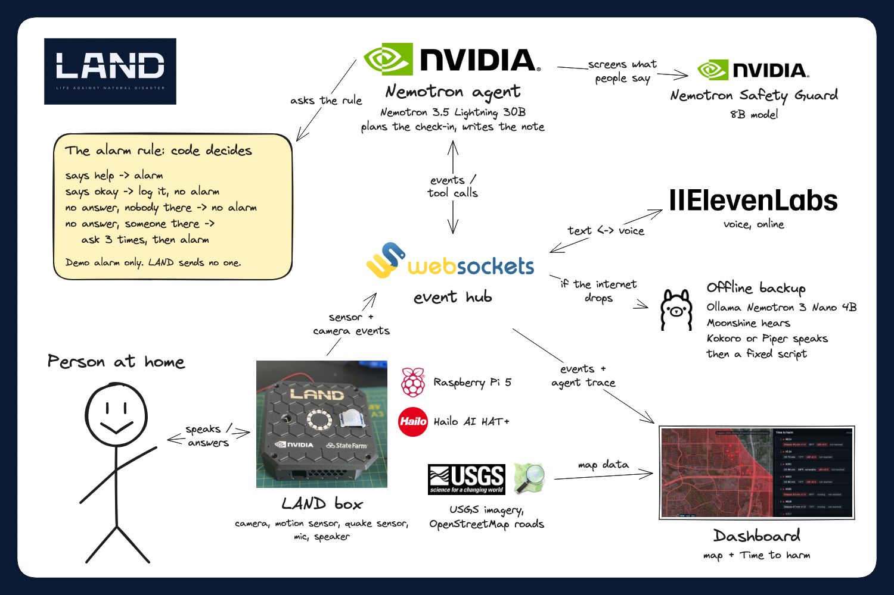

<p align="center">
<picture>
  <source media="(prefers-color-scheme: dark)" srcset="docs/brand/land-wordmark-white.svg">
  <source media="(prefers-color-scheme: light)" srcset="docs/brand/land-wordmark-navy.svg">
  
</picture>
</p>

# LAND

LAND is a safety box for the home. After an earthquake, or when someone in the room stops moving, it asks out loud if they are okay. If they say help, or do not answer three times, it raises a demo alarm on the dashboard.

We call this "no response after an event". The box does not diagnose anything. An event only starts a question.

Built at HackUTD 2026 "Zero Day" by Godfrey (software) and Rafael Amador (hardware).

## How it works



1. **An event.** A quake, a NOAA earthquake warning, or a person in the room who goes from moving to still.
2. **A voice check-in.** The box asks "Are you okay?" up to three times. ElevenLabs speaks and listens. A keyword match, not a model, sorts each answer into okay, help or no answer.
3. **A Nemotron agent.** NVIDIA Nemotron runs the check-in as an agent. Each turn it picks a tool, such as check presence, speak, listen or raise the alarm. Nemotron Safety Guard screens each transcript before the agent sees it. The box only says lines from a fixed list. Nemotron picks a line by its id.
4. **A fixed alarm rule.** Code decides the alarm, never the model ([`software/agent/rule.py`](software/agent/rule.py)):

   | Someone in the room? | Answer | Result |
   |---|---|---|
   | No | No answer | No alarm |
   | Yes | No answer after 3 asks | Alarm |
   | Either | "Help" | Alarm at once |
   | Either | "I'm okay" | Logged, no alarm |

   If Nemotron skips an alarm that the rule calls for, the code raises it. If Nemotron tries an alarm that the rule does not call for, the code refuses it.
5. **The hand-off.** After an alarm, Nemotron writes a short note for the responder and up to three lines on why the alarm fired. Code checks both. If a check fails, a plain template takes its place.
6. **The dashboard.** It is built for a city or county emergency team. It ranks every home hit by the quake by time to harm, in minutes. A home that says help, or raises an alarm, goes to the top. A home that misses calls moves up.

If the hosted model is down, the agent falls back to a local Nemotron 4B on Ollama, then to a fixed script. Voice falls back to offline models.

## What is real and what is simulated

Real:

- The check-in agent, the alarm rule, the agent trace and the hand-off note. The agent uses `nvidia/nemotron-3.5-lightning-30b-a3b` and Nemotron Safety Guard on NVIDIA's API.
- The voice check-in, with ElevenLabs speech-to-text and text-to-speech.
- The home screen and the dashboard. The hub serves both pages from one laptop. We run no server online. The agent and the voice service call NVIDIA's and ElevenLabs' APIs.
- The NOAA alert decoder ([`software/same`](software/same)). When we show it, it decodes a test recording that we feed in by cable, never over the air.
- The camera person detector ([`hardware/vision/posture.py`](hardware/vision/posture.py)). It runs on its own on the Raspberry Pi 5 with the AI HAT+. Its link to the hub is not tested yet.

Simulated:

- 499 of the 500 homes on the dashboard. Home H000 is our one real box. The other homes are seeded, with demo weights and simulated check-ins.
- The quake. It is a 0.82 g test event, sent with the hub simulator's `q` key or the same message from our filming control panel (not in this repo). No accelerometer sends data yet.
- Presence. In the demo, a control panel outside this repo sends the same `presence` messages as the simulator keys `m` and `s`. The camera is not connected yet.
- Battery and power. They come from the hub's simulator.
- The alarm. It is a demo alarm. The box plays a siren and the dashboard zooms to the home. No emergency number is called. With Twilio settings, the agent can call or text one teammate's phone. It is off unless the `TWILIO_` variables are set, and they are not set in the demo. The code never dials a short number like 911.

## Run it locally

You need Python 3.12. The web tests need Node 24. Run every command from the repo root.

Install the hub, agent and voice:

```bash
python3.12 -m venv .venv && .venv/bin/pip install -r software/hub/requirements.txt -r software/agent/requirements.txt -r software/voice/requirements.txt
```

Keys come only from environment variables. Never paste a key into a command line.

| Variable | Used by | Without it |
|---|---|---|
| `NVIDIA_API_KEY` | Agent: hosted Nemotron and Safety Guard | Mock mode. The agent tries a local Nemotron on Ollama, then the fixed script. |
| `ELEVENLABS_API_KEY` | Voice | Offline voice. |

Download the offline voice models once, with internet. The voice service needs them in every mode except `--text`:

```bash
.venv/bin/python -m software.voice --download
```

Start each part in its own terminal.

1. Hub, with the box simulator:

   ```bash
   .venv/bin/python -m software.hub --sim
   ```

2. Agent:

   ```bash
   .venv/bin/python -m software.agent
   ```

3. Voice. Add `--text` to type answers instead of speaking:

   ```bash
   .venv/bin/python -m software.voice
   ```

4. Web: the hub serves both pages. Open `http://localhost:8080/` for links to the dashboard (`/dashboard/`) and the home screen (`/home/`).

To try it, press keys in the hub terminal. Press `m` (someone is moving), then `q` (a test quake). The box asks if you are okay. Stay quiet three times, or say "help", and the alarm goes up. Press `r` to reset. The hub's other keys are in [`software/hub/README.md`](software/hub/README.md).

Tests:

```bash
.venv/bin/python -m pytest software
```

```bash
(cd software/web/dashboard && node --test)
```

```bash
(cd software/web/home && node --test)
```

Each part has its own README with more detail: [hub](software/hub/README.md), [agent](software/agent/README.md), [voice](software/voice/README.md), [dashboard](software/web/dashboard/README.md), [presence](software/presence/README.md), [NOAA alerts](software/same/README.md).

## Repo layout

```
software/hub/      WebSocket bus, box simulator, serves software/web/
software/agent/    Nemotron check-in agent and the alarm rule
software/voice/    speaks, listens, sorts the answer
software/web/      dashboard and home screen
software/presence/ camera boxes to presence events
software/same/     NOAA weather radio alerts to hub alerts
hardware/vision/   camera person detector on the Pi 5 + AI HAT+
hardware/radio/    NOAA weather radio receiver
hardware/case/     custom Pi 5 + AI HAT+ case (build123d source, PLAN.md)
tools/status/      local page that shows build status
docs/              project hub note, event info, ideas, plan, inventory, research, tracks
docs/brand/        LAND logo SVGs + PNG exports (redo the PNGs: sh docs/brand/export-png.sh)
```

## Hackathon notes

- Event: HackUTD 2026 "Zero Day", Sat Nov 7 12:00 PM to Sun Nov 8 12:00 PM, ECSW, UTD.
- Team: Godfrey (software and AI) and Rafael Amador (hardware and embedded).
- Project hub: [docs/HackUTD-2026.md](docs/HackUTD-2026.md) is the project hub note, with links to every note. The 24-hour plan is in [docs/HackUTD-Plan.md](docs/HackUTD-Plan.md).
- Tracks: [docs/tracks/HackUTD-Tracks.md](docs/tracks/HackUTD-Tracks.md) has the official tracks and prizes.
- Research: [docs/research/Research-Edge-AI-Brief.md](docs/research/Research-Edge-AI-Brief.md) is a one-page summary of the edge AI research.
- How we worked: GitHub issues were the shared queue between two Claude accounts ([docs/research/HackUTD-Research-Claude-Loadout.md](docs/research/HackUTD-Research-Claude-Loadout.md)).
